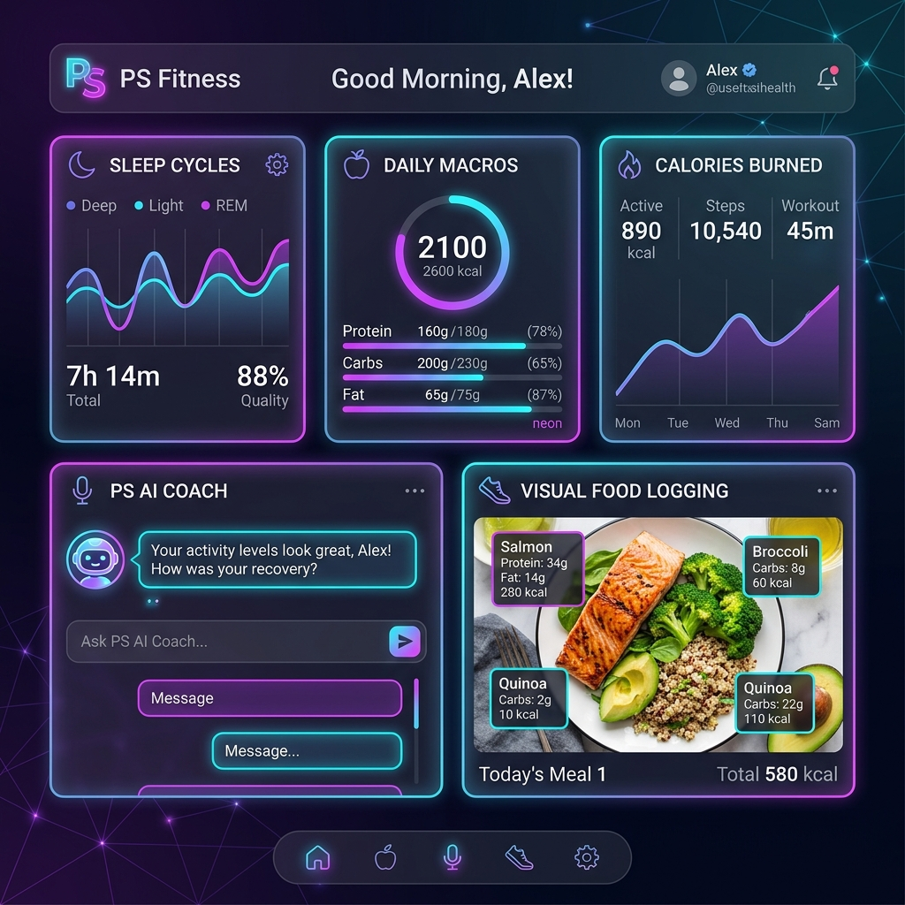
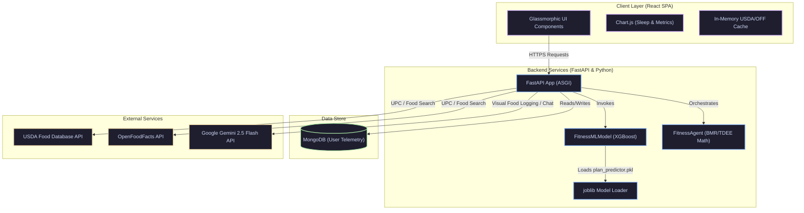

<div align="center">
  <h1>⚡ PS Fitness</h1>
  <p><b>Your Elite AI-Powered Health & Wellness Coach</b></p>
  
  [](https://reactjs.org/)
  [](https://fastapi.tiangolo.com/)
  [](https://www.mongodb.com/)
  [](https://deepmind.google/technologies/gemini/)
</div>

<br/>

<p align="center">
  
</p>

<br/>

> **PS Fitness** is a next-generation web application designed to democratize elite-level fitness coaching. By combining advanced multimodal Generative AI with a rich, glassmorphic dark-mode interface, the platform translates raw health data into strictly personalized, actionable guidance.

---

## 🌟 Core Features

### 🧠 The PS AI Coach (Context-Aware LLM)
Forget simple dashboards. The PS AI Coach acts as a 24/7 personal trainer right in your browser. Powered by **Google Gemini 2.5 Flash**, it dynamically analyzes your historical weight trends, caloric averages, and workout consistency to provide deeply personalized, empathetic, and data-driven advice.

### 📸 Frictionless Visual Food Logging
Typing out meals is obsolete. Using **Gemini Multimodal Vision**, users simply upload a picture of their plate. The AI instantly identifies the food items, estimates portion sizes, and natively calculates the complex nutritional macros to log directly into your Food Diary.

### ⚡ Lightning-Fast Nutrition Engine
- **Dynamic Meal Planner:** Immediately generate 3-to-5 meal daily plans tailored to specific calorie targets, macros, and dietary restrictions (e.g., Vegan, Keto) using an instantaneous local recommendation matrix.
- **Barcode & USD/OpenFoodFacts Integration:** Log packaged foods instantly via UPC/EAN scanning, or search the massive USDA database utilizing a highly-optimized in-memory intercept cache to guarantee `0.00s` autocomplete results for common foods.

### 💤 Holistic Habit Tracking
- **Workout Logger:** Intuitive interface for logging sets, reps, and weights.
- **Sleep & Recovery Analytics:** Interactive, beautiful **Chart.js** visualizations tracking your daily sleep cycles intersecting with your physical metrics to gauge true recovery.

---

## 🛠️ Technology Stack

**Frontend Architecture:**
- **React.js (v18)** - Component-based reactive UI
- **Chart.js** - Complex data visualization
- **Vanilla CSS** - Ultra-premium, custom glassmorphic styling system

**Backend & AI Architecture:**
- **Python / FastAPI** - High-performance, asynchronous REST API 
- **Google GenAI SDK** - Connecting to Gemini 2.5 Flash models
- **MongoDB** - Flexible NoSQL schema for rapid user telemetry ingestion

**External Integrations:** 
- USDA FoodData Central API
- OpenFoodFacts API

---

## 🚀 Quick Start Guide

### Prerequisites
- **Python 3.10+**
- **Node.js 18+**
- **MongoDB** (Running locally on `mongodb://localhost:27017` or via an Atlas connection string)

### ⚙️ 1. Backend Setup

Open your terminal and navigate to the `backend` directory:

```bash
cd backend

# Create and activate a Virtual Environment
python -m venv venv

# Windows
.\venv\Scripts\activate
# Mac / Linux
source venv/bin/activate

# Install dependencies
pip install -r requirements.txt
```

Create a `.env` file in the `backend` folder exactly like this:
```env
MONGODB_URL=mongodb://localhost:27017
DATABASE_NAME=fitness_ai
SECRET_KEY=your_secure_jwt_secret_key_here

GEMINI_API_KEY=your_google_ai_studio_api_key
USDA_API_KEY=your_usda_gov_api_key
```

Start the FastAPI server:
```bash
python run_server.py
```
*(The backend will run on `http://localhost:8000`)*

### 🎨 2. Frontend Setup

Open a **new, separate** terminal and navigate to the `frontend` directory:

```bash
cd frontend

# Install Node dependencies
npm install

# Start the React development server
npm start
```
*(The application will launch automatically on `http://localhost:3000`)*

---

## 📐 System Architecture

The diagram below outlines the end-to-end data flow and architectural layout of the platform, detailing how user inputs, database records, and machine learning components intersect:



---

## 🧠 Machine Learning Engine

Instead of relying solely on simple, static weight rules, **PS Fitness** incorporates a custom-trained **XGBoost Classifier** to suggest personalized fitness targets (`Cut`, `Bulk`, `Lean`, or `Recomp`).

### Pipeline & Features
The model acts on a 6-dimensional input vector representing user biometrics:
- **Height** (cm)
- **Weight** (kg)
- **Age** (years)
- **Gender** (Binary encoded: Female = `0`, Male = `1`)
- **Activity Level** (Ordinal mapping from `0` to `4` for Sedentary up to Extra Active)
- **Body Fat** (Percentage)

### Training & Cross-Validation
- **Algorithm**: Extreme Gradient Boosting Classifier (`xgb.XGBClassifier`) optimized with custom hyperparameters (`max_depth=5`, `learning_rate=0.1`, `n_estimators=200`, `subsample=0.9`).
- **Validation**: Evaluated using **5-Fold Cross-Validation** to guarantee model robustness, checking accuracy and class-specific metrics (F1-score, Precision, Recall).
- **Fallback Architecture**: Engineered with a robust dual-mode handler. If the pickled model (`plan_predictor.pkl`) is missing or fails to load, the backend automatically fails over to a rule-based BMI and activity multiplier algorithm, ensuring uninterrupted service.

The training pipeline, visual analysis generation (confusion matrices, feature importance plots), and model exports are fully encapsulated in [train_model.py](file:///d:/###HELLOOOOO/ps_fitness/backend/app/ml/train_model.py).

---

## 🗺️ Project Roadmap

- [ ] **Wearable API Sync**: Integrate Google Fit and Apple HealthKit for real-time sleep and workout sync.
- [ ] **Mobile Client (Flutter)**: Build a dedicated cross-platform mobile app leveraging the FastAPI REST endpoints.
- [ ] **Community Challenges**: Add social leaderboards, community workout routines, and shared macro plans.

---

## 📝 License

Distributed under the MIT License. See `LICENSE` for more information. 
